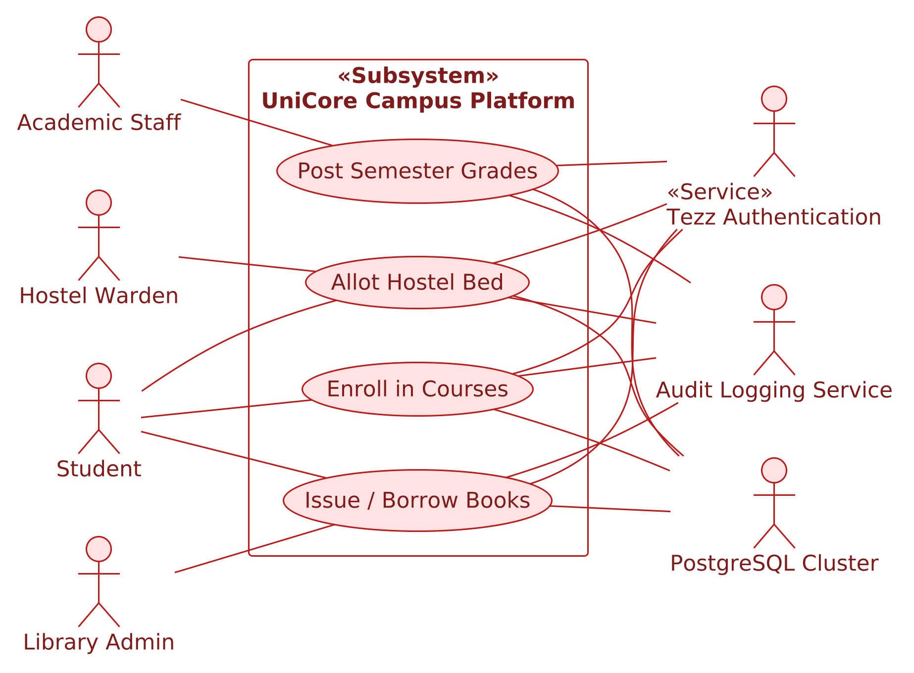
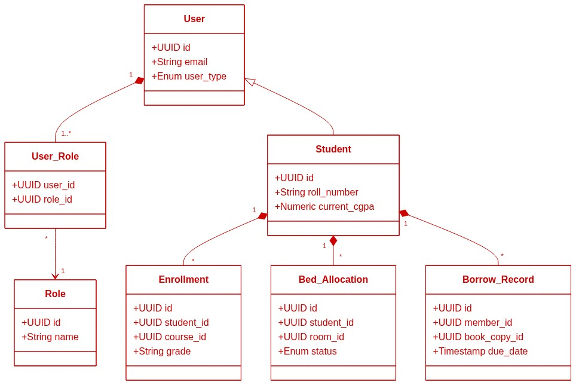
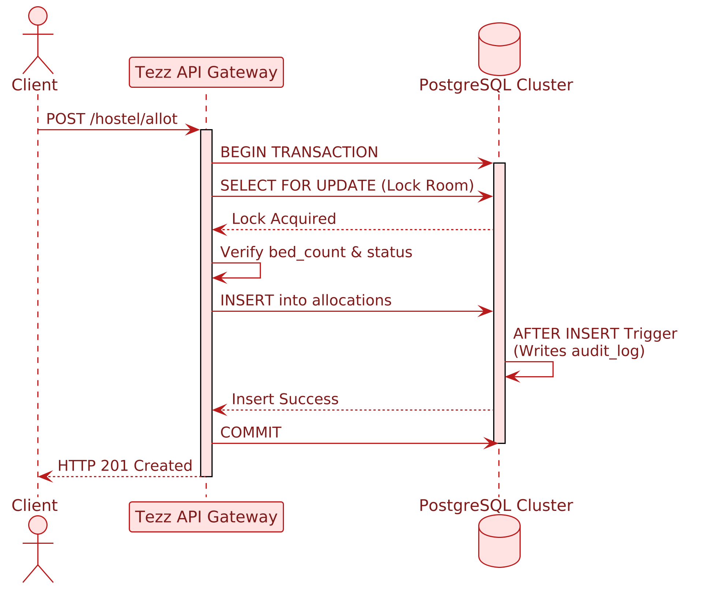
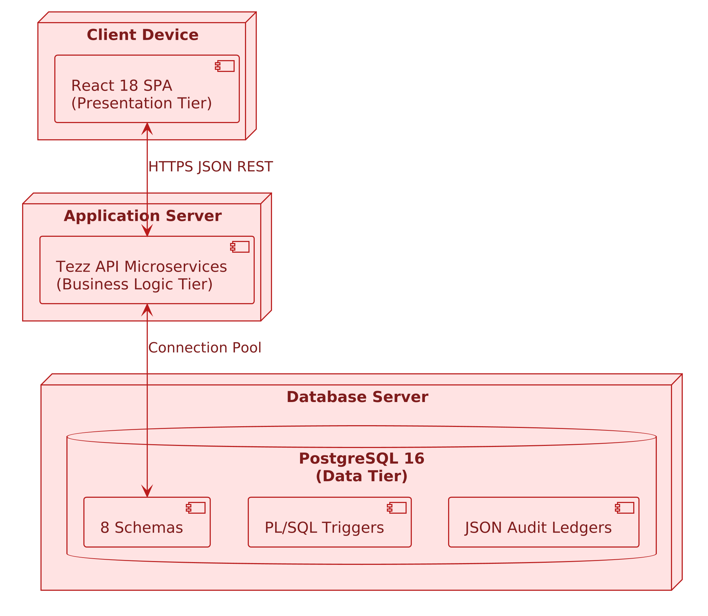
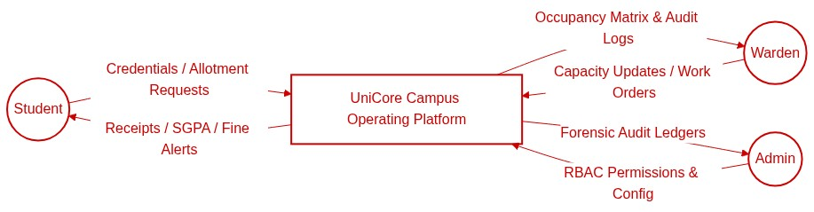
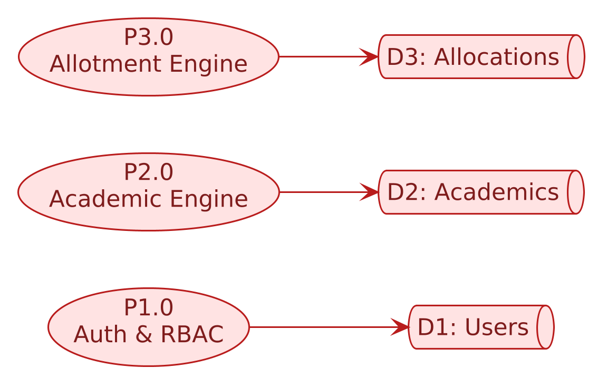

# Diagrams

All UML, data-flow, ER, activity, sequence and deployment diagrams for UniCore.

| Diagram | File |
|---------|------|
| Use case, class, sequence, component, DFD (Level 0 & 1) | [uml/uml_and_dfd.pdf](./uml/uml_and_dfd.pdf) · previews [below](#previews) |
| Sequence: student login and academic dashboard | [sequence/Sequence_diagram.pdf](./sequence/Sequence_diagram.pdf) |
| Activity: student services, exams and results, hostel and outpass, library | [activity/UniCore_Activity_Diagrams.pdf](./activity/UniCore_Activity_Diagrams.pdf) |
| Deployment: browser, GitHub Pages, Cloudflare Pages, Cloudflare Workers API, Turso database | [deployment/unicore_deployment_diagram.pdf](./deployment/unicore_deployment_diagram.pdf) · [HTML](./deployment/unicore_deployment_diagram.html) |
| **ER diagram**: main 24 tables, colour-coded by module | [er/unicore_er_overview.pdf](./er/unicore_er_overview.pdf) |
| ER: full reference, all 47 tables, generated from [`code/database/`](../../code/database/) | [er/unicore_er_diagram.pdf](./er/unicore_er_diagram.pdf) · [interactive HTML](./er/unicore_er_diagram.html) |

Regenerate the ER diagrams after a schema change: `python3 docs/diagrams/er/build_er_overview.py` and `python3 docs/diagrams/er/build_er_diagram.py`  
Regenerate the deployment diagram after an infrastructure change: `python3 docs/diagrams/deployment/build_deployment_diagram.py`

---

## Previews

### Use case diagram

### Class diagram

### Sequence diagram

### Component diagram

### Data flow diagrams
**Level 0 (context)**

**Level 1**

